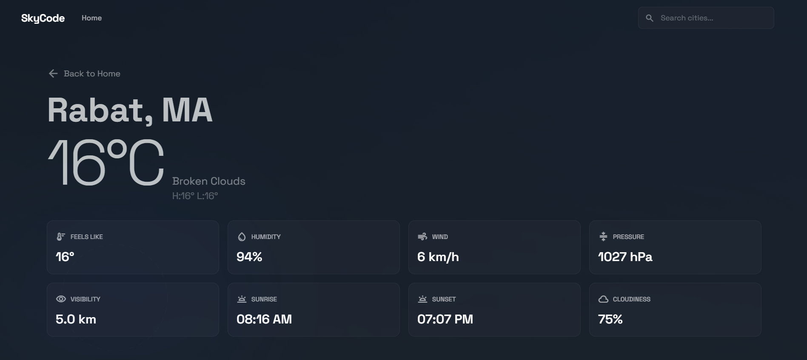

# SkyCode - Application Météo

Application de météo moderne et élégante construite avec React, Redux et Tailwind CSS.

## 📸 Capture d'écran



## 🌟 Fonctionnalités

- **Recherche de Ville** : Recherchez n'importe quelle ville dans le monde pour obtenir les conditions météorologiques actuelles.
- **Détails Complets** : Vue détaillée avec température ressentie, humidité, vent, pression, visibilité, nébulosité et heures de lever/coucher du soleil (à l'heure locale de la ville).
- **Favoris** : Ajoutez ou retirez des villes favorites depuis la page d'accueil ou la page de détails (dédoublonnage insensible à la casse, persistance locale).
- **Navigation Fluide** : Routage entre l'accueil, les détails des villes et une page 404.
- **Gestion des Erreurs** : États de chargement, messages clairs (ville introuvable, erreur réseau) et garde-fou global (ErrorBoundary).
- **Design Moderne** : Interface claire et épurée — fond dégradé doux (bleu/violet), cartes "glassmorphism" légères, animations et mise en page responsive mobile/desktop.

## 🛠️ Technologies Utilisées

- **[React](https://reactjs.org/)** : Bibliothèque JavaScript pour l'interface utilisateur.
- **[Redux Toolkit](https://redux-toolkit.js.org/)** : Gestion d'état globale de l'application.
- **[React Router](https://reactrouter.com/)** : Navigation et routes protégées.
- **[Tailwind CSS](https://tailwindcss.com/)** : Framework CSS compilé au build (PostCSS), plus aucun CDN.
- **[OpenWeatherMap API](https://openweathermap.org/api)** : Source des données météorologiques.
- **Axios** : Client HTTP pour les requêtes API.

## 🚀 Installation et Lancement

1. **Cloner le projet**

   ```bash
   git clone https://github.com/Anasselghalbzouri/AnassMeteo.git
   cd meteo
   ```

2. **Installer les dépendances**

   ```bash
   npm install
   ```

3. **Configurer la clé API**

   Copiez le fichier d'exemple et renseignez votre clé [OpenWeatherMap](https://home.openweathermap.org/api_keys) :

   ```bash
   cp .env.example .env.local
   ```

   ```
   REACT_APP_OPENWEATHER_API_KEY=votre_clé_api
   ```

4. **Lancer l'application**

   ```bash
   npm start
   ```

   L'application est accessible à l'adresse [http://localhost:3000](http://localhost:3000).

## 🔑 Connexion (démo)

L'authentification est actuellement **mockée** (à remplacer par un vrai backend) :

- Email : `user@example.com`
- Mot de passe : `password`

## 🧪 Tests

```bash
npm test            # mode interactif (watch)
npm run test:ci     # exécution unique (CI)
```

## 📦 Build de production

```bash
npm run build
```

## 📂 Structure du Projet

- `src/components` : Composants réutilisables (cartes météo, navigation, pages).
- `src/hooks` : Hook `useWeather` (chargement, erreurs, annulation et cache des requêtes).
- `src/utils` : Fonctions de formatage partagées (dates locales, unités, libellés).
- `src/store` : Store Redux et slice d'authentification.
- `src/slice.js` / `src/sliceFavorites.js` : Slices Redux (ville sélectionnée, favoris).
- `src/api` : Appels API (service d'authentification).
- `src/data` : Données initiales (villes favorites par défaut).

Anass El Ghalbzouri.
